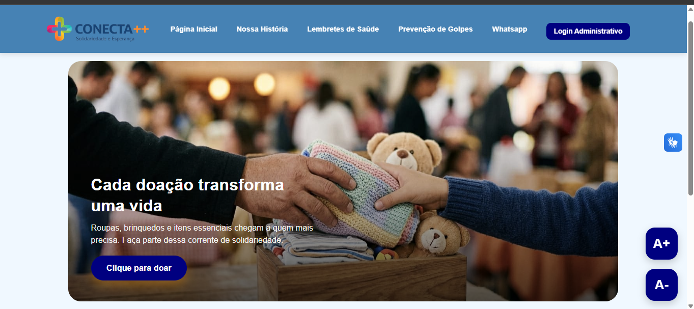
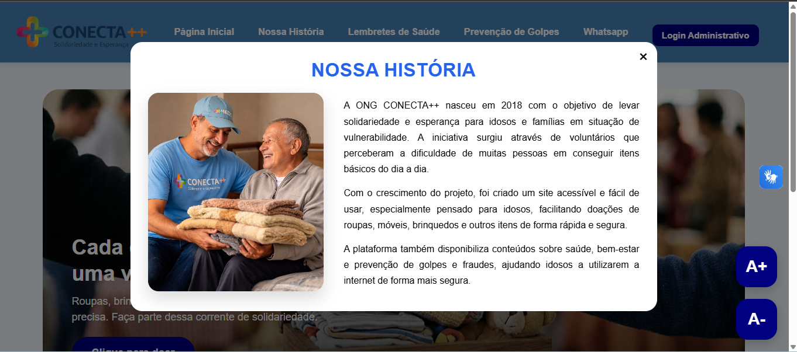
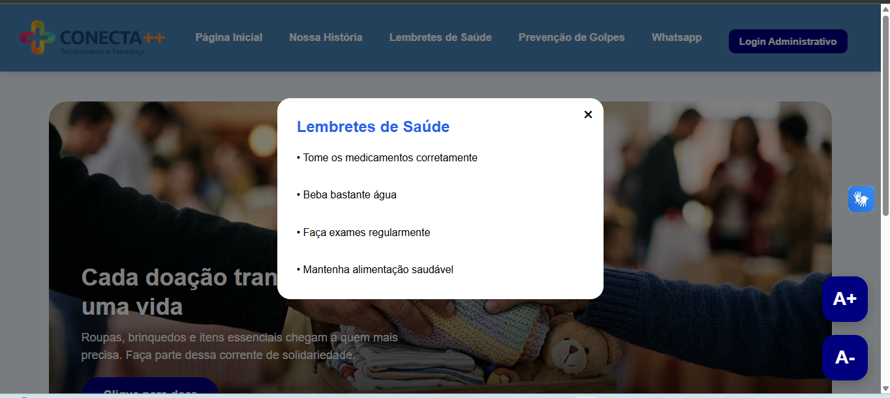
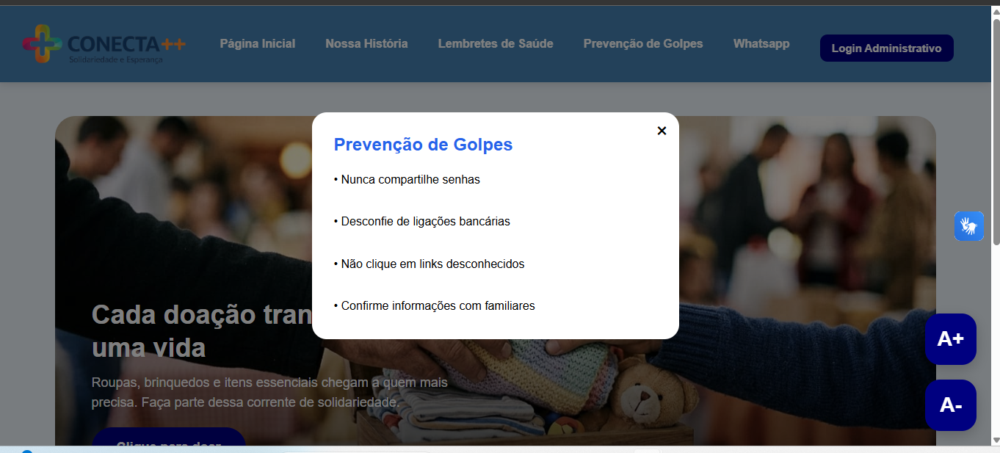
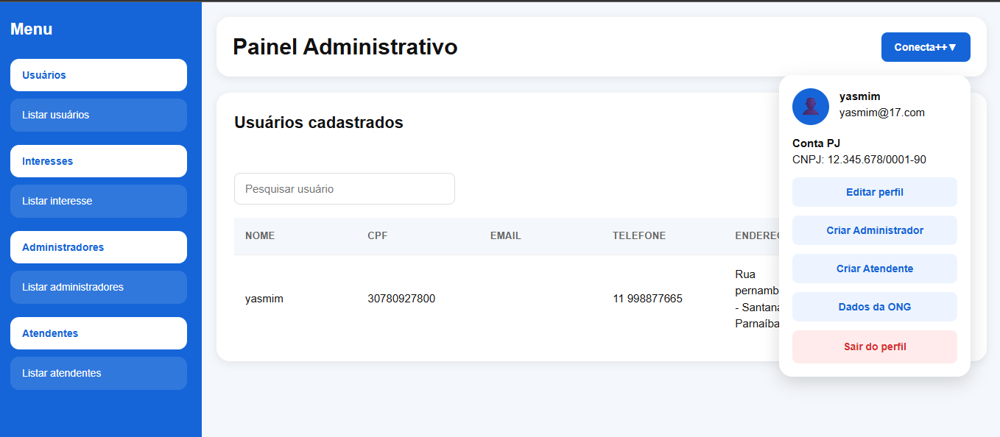
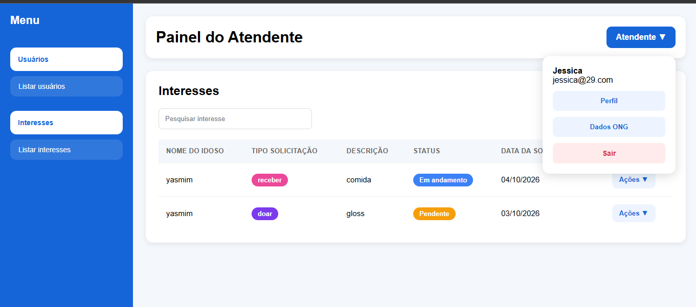

# Conecta++

**Mais apoio. Mais conexão. Mais qualidade de vida.**

O Conecta++ é um projeto acadêmico voltado ao apoio de pessoas idosas, com o objetivo de facilitar o atendimento realizado pela ONG, promover a inclusão digital e ampliar o acesso a informações e recursos de acessibilidade.

A solução é composta por um **site web**, destinado ao gerenciamento das informações e ao atendimento da ONG, e um **aplicativo em desenvolvimento**, pensado para auxiliar os idosos em suas atividades cotidianas.


---

## Sobre o projeto

O Conecta++ foi desenvolvido em equipe como projeto acadêmico do curso de Análise e Desenvolvimento de Sistemas.

O projeto tem como objetivo facilitar o gerenciamento das informações dos idosos atendidos pela ONG, permitindo o cadastro de usuários, o gerenciamento de administradores e atendentes e o acompanhamento de interesses e necessidades. Também disponibiliza conteúdos informativos relacionados à saúde e à prevenção de golpes.

Além do site web, está em desenvolvimento um aplicativo voltado ao apoio direto dos idosos, com recursos como agendamento de consultas, lembretes e acesso a informações úteis. A solução considera a acessibilidade como parte fundamental de seu desenvolvimento, incluindo o uso do VLibras para ampliar o acesso às informações.

## Status do projeto

- **Site web:** concluído.
- **Aplicativo:** em desenvolvimento.
- **API:** em desenvolvimento, utilizando C#/.NET.

---

## Funcionalidades

### Site Web

- Cadastro de idosos;
- Login de administradores e atendentes;
- Gerenciamento de administradores;
- Gerenciamento de atendentes;
- Cadastro e gerenciamento de interesses e necessidades;
- Consulta e atualização de registros;
- Conteúdos sobre prevenção de golpes;
- Lembretes de saúde;
- Página "Nossa História";
- Recurso de acessibilidade com VLibras.

### Aplicativo

- Acesso voltado aos idosos;
- Agendamento de consultas;
- Lembretes para auxiliar na organização do cotidiano;
- Acesso a informações úteis;
- Recursos de acessibilidade com VLibras;
- Funcionalidades voltadas à autonomia e à inclusão digital.

---

## Tecnologias utilizadas

### Back-end

- C#
- .NET
- API em desenvolvimento com C#/.NET.

### Front-end Web

- HTML5
- CSS3
- JavaScript

### Aplicativo Mobile

- Kotlin
- C#/.NET

### Banco de Dados

- SQL Server

### Acessibilidade

- VLibras — recurso de acessibilidade em Língua Brasileira de Sinais.

---

## 📁 Estrutura do projeto

```text
ConectaMaisMais
├── Aplicativo
├── Back-End
├── Banco_SQL
├── Front-End
├── Imagens
└── README.md
```

## Telas do Sistema

### Site Web

A seguir, estão algumas das principais telas do site web do Conecta++.

<table>
  <tr>
    <td align="center">
      <b>Tela Inicial</b><br>
      
    </td>
    <td align="center">
      <b>Nossa História</b><br>
      
    </td>
  </tr>
  <tr>
    <td align="center">
      <b>Lembretes de Saúde</b><br>
      
    </td>
   <td align="center">
  <b>Prevenção de Golpes</b><br>
  
</td>
  </tr>
  <tr>
    <td align="center">
      <b>Painel Administrativo</b><br>
      
    </td>
 <td align="center">
  <b>Painel do Atendente</b><br>
  
</td>
  </tr>
</table>

### Aplicativo

*Espaço reservado para imagens das funcionalidades de agendamento, lembretes, informações úteis e recursos de acessibilidade.*

---

## Como executar o projeto

As instruções de execução serão complementadas conforme a finalização da API e a integração entre os componentes da solução.

### Site Web

1. Abra o projeto no Visual Studio.
2. Configure a conexão com o SQL Server, conforme as configurações do projeto.
3. Verifique as dependências e os arquivos de configuração.
4. Execute a aplicação pelo ambiente de desenvolvimento.

### Aplicativo

As instruções de execução serão adicionadas após a conclusão das etapas de desenvolvimento e configuração do aplicativo.

---

## Equipe

Projeto desenvolvido em equipe como parte das atividades do curso de **Análise e Desenvolvimento de Sistemas**.

Este repositório foi publicado por **Yasmim Tomas** como parte de seu portfólio acadêmico e profissional.

---

**Conecta++ — Tecnologia, acessibilidade e inclusão para uma vida com mais autonomia e qualidade.**
